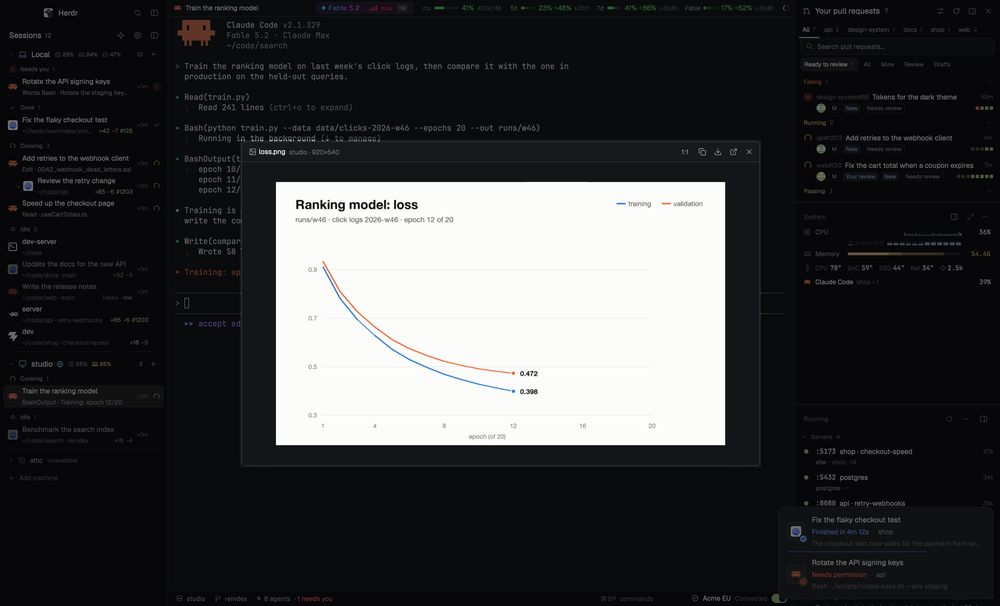

# Remote open

Pages, sign-ins and images that programs on the person's other machines open come up on the Mac
they're using. A sign-in whose callback is on that machine's localhost gets its port forwarded
back over ssh, so it finishes there. A localhost dev server opens here the same way. An image
shows in a floating Herdr window, and the terminal's right-click menu offers the images the
terminal printed, and a gallery of all of them. Nothing shows until a port is forwarded; then a small chip floats at the bottom
of the window.

## What you see

Every color comes from `theme()`. Icons are 24-unit stroke SVGs (lucide style, 2 px,
`currentColor`) in the mod's folder: `image`, `forward`, `x`, `copy`, `download`, `external`,
`fit`, `gallery` (lucide `images`), `prev`, `next` (chevrons), `refresh` (lucide `rotate-cw`). The menu's pane items reuse the shipped `mods/workspace-chrome/` icons (`panel-right`,
`square`, `terminal`, `x`).

- **Nothing**, while no port is forwarded: the floating block draws an empty `div`.
- **Chip** (floating block, bottom edge, centred): one 26 px line, 9 px padding, 6 px gap, 11.5 px
  `foreground` text: the `forward` icon (13 px, `accent`), then `:8085 studio` for one forward or
  `3 forwards`. Tooltip: "Ports forwarded from other machines. Click to see or stop them."
- **Forwards list** (a 320 px popup from the chip, as tall as its rows; or a 270 × 360 dialog from
  `mod.open`): on `popover`, 5 px padding. A 11.5 px `dim` heading, "Ports forwarded to this Mac"
  ("No ports are forwarded." when empty). One 44 px row each, radius 7, `hover` behind it on hover:
  the `forward` icon (`accent`), `localhost:8085` (semibold) over `studio · until stopped` or
  `studio · sign-in, 7 min left` (11 px `dim`), then **open** and **stop** icon buttons. With two
  or more, a `border` rule and a 31 px **Stop all** row.
- **Image viewer** (a floating window, sized to the picture: fitted into 1100 × 760, at least
  380 × 240, plus the bar):
  - A 36 px title bar with a `border` line under it, 12 px left padding: the `image` icon
    (`muted`), the file's name (semibold, never truncated), then in 11.5 px `dim`, truncated,
    `studio · 1200×700` (`this Mac` for a local terminal; the full remote path in its tooltip),
    plus ` · 3 of 22` when opened from the gallery.
    A note replaces that text for 2.5 s after a button (`Copied to the clipboard`,
    `Saved to Downloads as shot (2).png`).
  - At the right, 24 px buttons, radius 6, `muted`, `hover` + `foreground` on hover: from the
    gallery only, **prev** and **next** (tooltips "Previous image (←)", "Next image (→)"); **1:1** as
    a text label while fitted, the `fit` icon at actual size; **copy**; **download**
    (Save to Downloads); **external** (Open in its app); **x** (Close).
  - The body on `canvas` (falling back to `background`), 8 px padding, the image centred: fitted
    to the body while fitting, else at its own size, scrolling both ways.
- **Markdown viewer** (a floating window, 760 × 680): the image viewer's title bar with the
  `markdown` icon (a page with lines) and `studio` (or `this Mac`) as its text, and the buttons
  **copy** (the markdown source, `cx.write_to_clipboard`, note `Copied the markdown`),
  **download**, **external** and **x**; no fit. The body is `TextView.markdown` from `gpui-base`,
  selectable and scrollable, 22 px side and 14 px top padding, 13.5 px type in `foreground`.
- **Terminal menu** (pointer popup, 270 × 360 from `mod.json`): on `popover`, 5 px padding,
  12.8 px type. 31 px rows, radius 7, 8 px padding, 9 px gap: a 14 px icon (`muted`), the label
  (truncated, tooltip), the key in 11 px `dim` at the right. The selected row (arrow keys) on
  `selected`, hovered rows on `hover`, 1 px `border` rules between groups:
  - up to four images and markdown files, newest first, `Open chart.png`, the `image` or
    `markdown` icon, tooltip `machine: path`;
  - **All images…** with the `gallery` icon and, as its key, how many the screen shows (`22`;
    nothing for none). Tooltip "Every image and markdown file this terminal printed". There for
    every terminal, since history can hold some the screen doesn't;
  - Herdr's own pane items, as the shipped menu has them: Split right, Split down, Zoom, then
    "Send right-clicks to pane" (or "Use Herdr right-click menu"), "Send back to <parent>" for a
    parked terminal, and after a rule Close pane. Split, Zoom and Close only for a terminal in a
    tab.
  - A row that is copying a file pulses (opacity 0.45 to 1, 900 ms).
- **Gallery** (a floating window, 884 × 620): the viewer's title bar with the `gallery` icon,
  **All images** (semibold), then in `dim` the terminal's title (or name, or address) and machine,
  `· 4 images, 1 markdown file` (`· looking…` first, `· looking further back…` while history
  loads, `· none` when done empty), with the **refresh** ("Look again") and **x** buttons. The
  body on `canvas`, scrolling down, 10 px padding, tiles wrapping with an 8 px gap:
  - a tile is 196 px wide, 6 px padding, radius 8, `hover` behind it, its path as tooltip: a
    124 px picture box on `background`, radius 6, with the picture fitted inside it (never
    enlarged), then the file name in 11.5 px, truncated;
  - before its picture is made the box shows the `image` icon (22 px, `dim`) pulsing (0.4 to 1,
    1100 ms); a markdown file shows the `markdown` icon; a picture that couldn't be made shows
    `x`, with the reason under the path in the tooltip;
  - a tile opening its file pulses like a menu row;
  - with nothing found: "This terminal hasn't printed the path of an image or markdown file
    that's still there." in 12.5 px `dim`.

## How it behaves

**A request.** On the other machine, `herdr-open <url or file>` (its `BROWSER`, and on Linux
also `xdg-open`) puts one JSON label on its own terminal:
`remote-open.req.<id>={"v":1,"id":"<16 hex>","t":<ms>,"arg":"…","cwd":"/abs"}`. Every key carries
the id, so two requests at once never meet. Every Herdr window showing that machine sees it in
`terminals()`; the watcher scans every 300 ms. herdr-open polls `hc get` five times a second for
3 s. On an ack it takes off its request and the bids, leaves the ack, and exits 0. With none it
writes `remote-open.ack.<id>=-`, waits 500 ms and reads it back: still `-`, it clears everything
and hands the argument to the machine's own opener; a Mac's name, it exits 0. A trap on INT, TERM
and HUP clears its labels. Requests already there when the watcher starts are seen but never
answered, for as long as their label stays.

**Which window.**
- Each window bids `remote-open.bid.<id>.<mac>=<lastUse>`. `lastUse` is now minus the Mac's idle
  time (`HIDIdleTime` from `ioreg`) while Herdr is in front, else the moment it stopped being in
  front.
- It waits 150 ms if it's in use (`window().active` and touched in the last 30 s), else 800 ms.
  Then it reads the labels with `hc get`, since `terminals()` can lag.
- It gives up when the request is gone, an ack is there, its bid isn't the latest (ties go to the
  name that sorts first), or more than 1.8 s have passed since it first saw the request.
- Otherwise it acks `remote-open.ack.<id>=<mac>`, waits 300 ms and reads the ack back. It opens the
  request only if the ack still names it, and takes the ack off 5 s later.
- It always takes its own bid off.
- `<mac>` is `hostname -s`, cleaned to `[a-z0-9-]`, plus a 6-hex tag kept in
  `data/remote-open/id`.
- Any `remote-open.*` label seen for more than 2 minutes is removed.

**What it takes.**
- `http(s)` URLs. On `localhost`, `127.0.0.1` or `[::1]` with an explicit port of 1024 or more,
  it forwards that port until stopped. A sign-in gets its port forwarded for 10 minutes. A URL is
  a sign-in when one of these parameters (query or fragment) holds such a URL:
  `redirect_uri`, `redirect_url`, `redirect`, `redirect_to`, `callback`, `callback_url`,
  `return_to`, `return_url`, matched case-blind with `_`/`-` ignored. It is also a sign-in when
  `continue`, `next`, `target`, `url`, `goto`, `dest`, `destination` or `fromURI` holds a URL
  with one. Anything else opens with `cx.open_url`.
- Files: an absolute path, `file://` URL or a path relative to `cwd`. Images
  (`png jpg jpeg gif webp bmp svg`) and markdown (`md markdown`) open in their viewers;
  `pdf txt csv json log` open with
  `/usr/bin/open`. Any other kind, `.html` included, is left alone (no bid), so its machine opens
  it.
- Other schemes are left alone.

**Forwards.**
- `ssh -f -T -M -S <data/remote-open/cm/PORT.sock> -o BatchMode=yes -o ExitOnForwardFailure=yes
  -o ControlPersist=no -o ConnectTimeout=10 -o ServerAliveInterval=30
  -L 127.0.0.1:PORT:<host>:PORT`, then `-N` for a page or `sleep 600` for a sign-in, to the
  machine's `target` from `hc machine ls --json`.
- One at a time per port: a second request for it waits for the first.
- A port already forwarded from the same machine is reused (a sign-in restarts its 10 minutes,
  waiting up to 1.5 s for the old ssh to let go of the port).
- It refuses when the port is forwarded from another machine, or when something on this Mac
  already listens on it (`net.connect` to `127.0.0.1` and `::1`).
- Records go to `data/remote-open/forwards.json`, written `pending` before ssh starts. At start
  each is checked with `ssh -S sock -O check`; dead ones get `-O exit` and are dropped, and so does
  any socket in `cm/` with no record. Pending records older than 40 s are settled every 30 s.
- Stop is `-O exit` on that socket. ssh needs a host there, but any name works.
- Toasts: "Sign-in opened here" / "Opened :5173 from studio", or the error.

**Files.**
- First `/bin/sh -c '[ -f "$1" ] && [ -r "$1" ] || exit 3; exec wc -c <"$1"'` (with `on` for
  another machine): only regular files.
- Up to 5 MiB: `/bin/sh -c 'exec base64 <"$1"'` with `on`. The bytes are decoded and their
  length checked against the size.
- Up to 100 MiB: `scp -q -o BatchMode=yes -- target:path local`.
- Local terminals: `/bin/cp`.
- Copies go to `data/remote-open/cache/<base36 time>-<fnv1a of machine:path>-<name cleaned to
  [A-Za-z0-9._-]>`, are checked again against 100 MiB, get
  `xattr -w com.apple.quarantine "0081;<hex time>;Herdr;"`, and are swept after 3 days.
- An image over 16,384 px a side or 64 Mpx opens with `open` instead of the viewer, and so does
  markdown over 2 MiB.
- Markdown goes to its viewer as text in its props, decoded from UTF-8 in model.js (the runtime
  has no `TextDecoder`; a bad byte becomes U+FFFD), under the key `remote-open-markdown`.
- Its links: `http`/`https` open with `cx.open_url` (`on_link_click`); relative links and
  anchors do nothing.
- The viewer is `openOverlay({kind:"window", key:"remote-open-viewer", …})`, so a new image
  replaces the one shown. Its size comes from the image's own header (PNG, GIF, BMP, WebP, JPEG
  SOF, SVG `width`/`height`/`viewBox`).

**Viewer.**
- From the gallery, ← and → (and the buttons) open the previous or next of the gallery's images
  in the viewer's place, with the list in its props (`set: {paths, at}`); nothing past either
  end, and one at a time.
- Esc closes it; Space or F switches between fit and 1:1. Key commands `close` and `fit`
  (`nextCommand()`) do the same.
- Copy runs JXA `osascript` putting an `NSImage` on the general pasteboard.
- Save copies into `~/Downloads` with `cp -n`, as `name (2).png` when the name is taken, checking
  with `test -e`.
- Open runs `open` on the cached copy: the person's app for that type, usually Preview.
- Buttons stop `mouse_down`, so dragging works only from the bar's empty parts.

**Menu.**
- On open it runs `hc read <terminal> --lines 0`: the screen only. For the terminal on screen,
  which the right-clicked one always is, a read with history takes 1 to 4 s (Herdr 0.1.16) and
  often returns the screen alone; the screen comes back in about 10 ms. It finds image paths in
  that text, quoted ones first, and bare ones not inside a quoted span; `file://` is decoded. A
  bare match with spaces before it back to a word that starts with `/` or `~/` (a macOS
  screenshot's `…/Screenshot 2026-09-22 at 20.12.45.png`, printed unquoted) is offered whole as
  well, first.
- It checks them on that machine with one `/bin/sh` test, `~` and relative paths resolved
  against the terminal's cwd, at most 120 of the newest, and keeps the files. The four newest
  get rows; the count goes on **All images…**.
- Choosing an image hands the job to the watcher's inbox and closes the menu at once. A closed
  menu would drop a copy halfway. With no live watcher it copies the file itself and closes after.
- Pane items run the same commands as the shipped menu, with `target.pane` / `target.terminal`.
  Hints come from `keys()`. Up/Down/Enter/Esc work.
- **All images…** closes the menu and opens the gallery with `{view:"gallery", terminal, cwd}`.

**Gallery.**
- Opened by the menu row, or by the watcher's key command: `gallery` for the focused terminal
  (`focused().shown`, else `.terminal`), `gallery:<address>` for that one. Only the watcher on
  duty answers; an unknown terminal gets an error toast. `openOverlay({kind:"window",
  key:"remote-open-gallery"})`, so opening another replaces it.
- It finds files as the menu does, up to 120, and shows them in the order printed. Then it reads
  3000 lines of history (`hc read --lines 3000`, seconds for the terminal on screen) and adds
  what that finds before them. Tiles already there keep their pictures; ones the second read
  missed stay at the end. A program on the alternate screen, like Claude Code's fullscreen view,
  has no history, so the screen is all there is.
- Each image's picture, four at a time: `sips -Z 480 -s format png <file> --out
  <cache>/<cache name>.thumb.png`, straight from the file for a local terminal. From another
  machine the file is copied first, as for the viewer, and that copy is deleted once the picture
  is made; the picture gets the quarantine flag. An SVG is drawn as it is. The picture's size
  comes from its header.
- A tile opens its file with the same `openFile` as the viewer, from the gallery's own copy
  (the window stays open, so nothing is dropped). An image passes the gallery's images as
  `set`. One at a time.
- **refresh** starts again from nothing; a read still running from before is ignored. Esc, and
  the key command `close-gallery`, close it. Closing drops the pictures still being made.

## Built from

- **Layout:** a floating block at the root of each of the person's own layouts,
  `{"id":"remote-open","content":{"mod":"remote-open"},"edge":"bottom","align":"center"}`, and
  `"terminal_menu": "remote-open"` at the root. `scripts/install.py` adds both, never to Herdr's
  shipped layouts, and leaves another custom terminal menu alone.
- **mod.json:** `{"place":"none","title":"Remote open","overlay":{"kind":"dialog","width":270,"height":360}}`.
- **One mod, roles by `props()`:**
  - `{view:"image"}`: the viewer;
  - `{view:"markdown"}`: the markdown viewer;
  - `{view:"gallery"}`: the gallery;
  - `{view:"forwards"}`, or any copy with an `overlay` and no `tab` (`mod.open`): the forwards
    list;
  - `{tab:"pane"}`: the terminal menu;
  - any other `tab`: closes itself;
  - none: the watcher, which also takes the key command `gallery`.
- **Files:** `model.js` (pure: request parsing, loopback and sign-in detection, bids, base64,
  image headers, path finding, cache names), `host.js` (`exec`, `hc`, `fs/promises`, `net`), `views.js`,
  `main.js`.
- **herdr:** `terminals`, `panes`, `keys`, `props`, `window`, `run`, `hc`, `exec`, `notify`,
  `openOverlay`, `closeOverlay`, `nextCommand`, `focused`, `checking`, `appHome`, `home`, `theme`.
  `cx.open_url`, `cx.spawn`, `cx.sleep`, `cx.timer.every`, `cx.focus_handle`.
- **Commands it runs here:** `ssh`, `scp`, `ioreg`, `hostname -s`, `osascript`, `open`, `cp`,
  `test`, `xattr`, `sips` (the gallery's pictures), `/bin/sh -c` (size check). Through `hc exec --on`: `/bin/sh -c` scripts for the
  size check, `base64` and the menu's existence check. `hc get` and `hc label` for the election.
- **On the other machines:** `remote/herdr-open` (POSIX sh: `od`, `grep`, `hc label`, `hc get`)
  in `~/.local/share/herdr-open/bin`, and a marked block in one shell startup file that sets
  `BROWSER` only when `HC_TERMINAL_ID` is set. `scripts/machines.sh` puts both there through
  `hc file write` and `hc exec -i … /bin/sh -s`.

## Watch out

- **Mods can't see clicks on terminal text.** ⌘-clicking a printed path or link is Herdr's. The
  right-click menu is the closest hook; don't promise "click an image" beyond that.
- **The runtime's `fs` doesn't reach every folder** (`/private/tmp`, `~/Downloads`). Copy local
  files with `/bin/cp` and save with `cp -n`; `fs` is fine inside `appHome()/data`.
- **macOS's `base64` takes no file argument** (it wants `-i`). Feed it stdin, which every
  `base64` reads.
- **A closed copy drops its pending calls.**
  - The menu closes on click, so the copy has to happen in the long-lived watcher.
  - Module scope is shared by all copies, so ownership is a timestamp that goes stale (2 s), not a
    promise. Only an armed copy (name known, first scan done) takes it.
  - A host-call promise kept in module scope can hang forever when the copy that started it
    closes. Restart such a load after 20 s, and never make arming wait on it.
- **Labels are last-write-wins and `terminals()` lags.** One key per request, read back with
  `hc get` after acking; without that, two Macs open the same thing, and a request killed with
  Ctrl-C is answered ten minutes later.
- **`ssh -f` keeps `exec`'s pipes open** and the call never returns. Start it through
  `/bin/sh -c 'e=$1; shift; exec ssh "$@" </dev/null >/dev/null 2>"$e"'` with stderr in a file.
  Control socket paths must stay under ~104 bytes; the mod checks 84.
- **`exec` output is capped at 8 MiB**, which is why base64 is only used up to 5 MiB.
- **`image(path)` resolves against `appHome()`**, so the viewer is given
  `data/remote-open/cache/<name>`, not an absolute path.
- **Pictures don't show while the Mac's screen is locked.** Herdr keeps drawing the window, but a
  picture it hasn't loaded before stays blank until the screen is unlocked; ones it has drawn
  before show. Check the lock (`ioreg -n Root -d1 -a`, `CGSSessionScreenIsLocked`) before
  debugging an empty image, and take pictures of the gallery unlocked.
- **Don't let the gallery decode full images.** Twenty retina screenshots are hundreds of MB once
  decoded; the tiles get `sips` copies instead.
- **A copy waiting on `nextCommand()` never settles.** The tests' `settle()` gives each round
  20 ms rather than waiting for every task, and commands sent back to back need a settle between
  them, or the second finds no copy listening.
- **`closeOverlay(null)` throws** in `checking()`; guard it, and don't spawn timers or `exec`
  there.
- **`hc get --json` may put a space after a colon**; herdr-open's ack grep allows for it.
- **The local port is the remote one.** It can't be remapped, since the redirect names it. A
  busy port is an error, not a silent remap.
- **Two Macs, same machine:** both see each request; without the election both would open it.
- **`set -e` in a loop over machines** stops at the first failure; handle each one.
- **Rewriting a shell file between markers** can eat the rest of it when a marker was edited:
  check that they pair up first.
- **Assumes:** macOS on this side; ssh to each machine without prompts (`BatchMode=yes`); `hc` on
  the other machines; `python3` for the installer.
